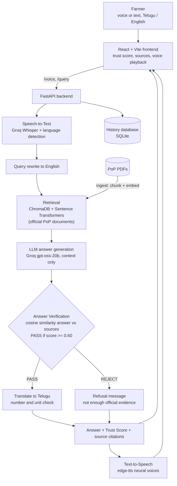
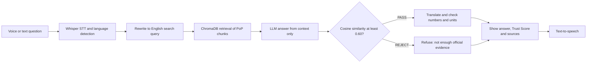

# Voice-Based Multilingual Agricultural Advisory System

> Ask a farming question by voice or text in **Telugu, Hindi or English**. The answer is released **only if it is verified** against official agricultural documents.


Final-year AIML major project, VVIT (AIML-C10). Most agricultural chatbots return an LLM answer with no check on whether it is supported by evidence. This system generates the answer from retrieved Package of Practices (PoP) text and then **verifies it before the farmer sees it**: cosine similarity between the answer and the retrieved evidence, threshold `τ = 0.60`. Answers that fail verification are refused instead of shown.

## Features

- Voice or text questions in Telugu, Hindi and English (Groq Whisper speech-to-text)
- Retrieval from official PoP PDFs (ChromaDB + `all-MiniLM-L6-v2`)
- Answer generation restricted to the retrieved context (Groq `openai/gpt-oss-20b`)
- **Answer verification with a visible Trust Score** (PASS / REJECT at `τ = 0.60`)
- Source citations (file and page) for every answer
- Safe Telugu/Hindi translation: numbers and units are checked after translation, and a failed translation is never shown as a confirmed answer
- Spoken answers (edge-tts neural voices), played in short pieces so playback starts quickly
- History of previous questions

## How it works





Verification is always done on the **English** answer against the English source text. Translation happens only after an answer has passed.

## Screenshots

| English verified answer | Telugu verified answer |
| --- | --- |
|  |  |

| English, second example | Hindi answer |
| --- | --- |
|  |  |

| English refused (not in documents) | Telugu refused |
| --- | --- |
|  |  |

## Evaluation

`python src/evaluate_verifier.py` runs the full pipeline on a labelled question set and compares **plain RAG (every answer released)** with **RAG + verification**. Questions are labelled PASS (answer is in the documents), REJECT (not in the documents) or BOUNDARY (partly covered; not counted in accuracy).

| | English (30 questions) | Telugu (20 questions) |
| --- | --- | --- |
| Plain RAG: unsafe answers released (question not in documents) | 10 / 10 (100%) | 5 / 5 (100%) |
| RAG + verification: unsafe answers released | 4 / 10 (40%) | 1 / 5 (20%) |
| RAG + verification: valid answers wrongly refused | 6 / 15 (40%) | 3 / 13 (23%) |
| Accuracy on PASS/REJECT rows | 60.0% | 77.8% |
| ROC-AUC of the cosine score | 0.62 | 0.77 |
| Mean score, answerable / unanswerable | 0.637 / 0.596 | 0.664 / 0.498 |

Verification cuts unsafe releases from 100% to 40% (English) and 20% (Telugu), at the cost of refusing some valid answers. The threshold sweep in the output shows this trade-off: a lower `τ` refuses fewer valid answers but lets more unsafe ones through. The question sets are small, so these numbers are indicative, not definitive.

## Quick start

```bash
python -m venv venv
venv\Scripts\activate
pip install -r requirements.txt
copy .env.example .env
```

Put your Groq key in `.env`, then build the knowledge base and start the backend:

```bash
python src/ingest.py
python run_api.py
```

In another terminal, start the UI:

```bash
cd frontend
npm install
npm run dev
```

Open http://localhost:5173

Run the evaluations:

```bash
python src/evaluate_verifier.py
python src/evaluate_verifier.py data/test_questions_telugu.csv
```

## Project layout

```text
src/                 FastAPI backend: RAG, verification, translation, STT, TTS
  pipeline.py        retrieve -> generate -> verify -> translate
  verify.py          cosine-similarity verification (tau = 0.60)
  language.py        language detection, safe translation, speech text
  evaluate_verifier.py   with vs without verification
frontend/            React UI: trust score, sources, voice playback
data/raw_pdfs/       knowledge-base PDFs (official PoP documents)
data/test_questions.csv, test_questions_telugu.csv   evaluation sets
docs/screenshots/    images used in this README
```

## Tests

```bash
python -m unittest src.test_language_speech
```

## Limitations

- Cosine similarity measures how close the answer is to the evidence, not whether every fact in it is correct. A fluent but wrong answer can still score high, so the Trust Score supports, and does not replace, expert advice.
- The knowledge base covers only the PDFs in `data/raw_pdfs/`; other questions are refused.
- Retrieval uses an English-only embedding model, so Telugu and Hindi questions are rewritten to English first; a poor rewrite lowers retrieval quality.
- Hindi has basic support and limited testing; Telugu and English are the primary languages.
- The prototype stores query history in SQLite. PostgreSQL is the planned production database.
- Advice is decision support for farmers, not a replacement for the local agriculture officer.

## Future work

- Claim-level verification (check each statement of the answer separately)
- Multilingual embeddings so Telugu and Hindi text can be retrieved directly
- Larger evaluation sets and wider Hindi testing
- PostgreSQL for production, and a trusted-source web fallback for questions outside the documents

## Team

Vasireddy Venkatadri Institute of Technology (VVIT), AIML-C10  
Guide: Mr. Merigala Kishore Babu

| Roll | Name |
| --- | --- |
| 24BQ5A6114 | Shaik Farzana |
| 24BQ5A6116 | Thummalagunta Sumanth |
| 23BQ1A61F6 | Pratikantam Veda Priyanka |
| 23BQ1A61B6 | Ravela Rupesh |